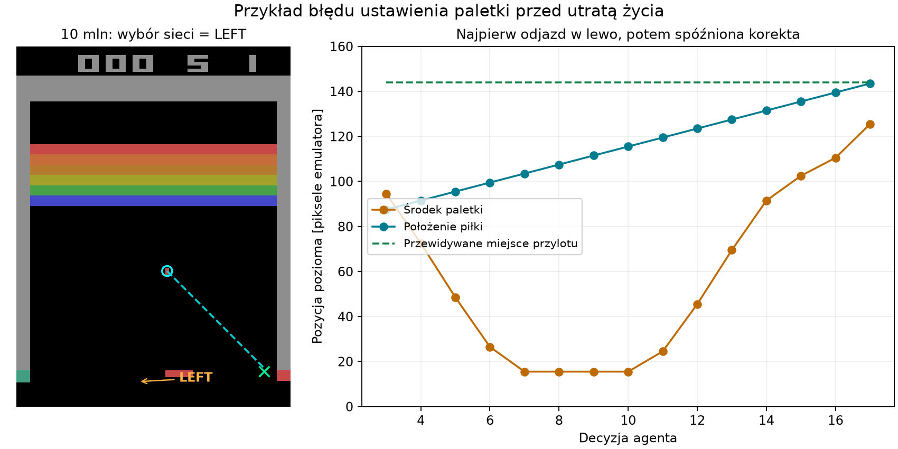

# Diagnoza Double DQN rewizja 2 przy 10 mln decyzji

Stan z 15 listopada 2026. Analiza na CPU, bez zmiany aktywnego treningu.
Źródła treningu są zamrożone z commita `e0948cf`. Nie dodano PER, n-step ani dueling.

## Wniosek i granice diagnozy

Potwierdzono błędy przewidywania przylotu piłki i wyboru ruchu paletki, także
wtedy, gdy pozostaje czas na obronę. Model słabo rozróżnia niektóre sytuacje
prowadzące do utraty życia. Jednocześnie pomocniczy bonus stanowi około 41%
sygnału nagrody i zmienia względną opłacalność rodzajów odbić.

Nie ustalono jednej wyłącznej przyczyny plateau. Nie znaleziono błędu wzoru
Double DQN, resetowania optymalizatora ani zapadniętej konwolucji. Duży bonus
nie jest sam w sobie dowodem, że powoduje obserwowaną regresję.

## Regresja zachowania

W oficjalnych ocenach na tych samych 100 seedach średnia spadła z 166,01 przy
7 mln do 116,77 przy 9 mln; 69 gier pogorszyło się, 31 poprawiło. Przy 10 mln
średnia wróciła do 151,03, nadal poniżej 7 mln.

Dodatkowo wykonano po 8 pełnych gier na wspólnych nowych seedach
391647281–391647288, epsilon 0, sticky 0,25, frame skip 4, automatyczny FIRE.
Wszystkie gry zakończyły się naturalnie przed diagnostycznym limitem 10000
decyzji. Są to małe próby diagnostyczne, nie nowe oficjalne oceny 100 gier.

| Checkpoint | Średnia punktów | Odbicia / życie | Punkty / wymianę |
|---|---:|---:|---:|
| 7 mln | 225,875 | 11,70 | 3,86 |
| 9 mln | 114,875 | 8,25 | 2,78 |
| 10 mln | 153,375 | 9,68 | 3,17 |

Pogorszenie obejmuje zarówno utrzymywanie piłki, jak i punkty na wymianę.
Nie znaleziono bezpunktowych wymian w 1185 zarejestrowanych wymianach.
Nie ma więc dowodu farmienia samych pustych odbić. Pojedyncze wymiany dawały
do 151, 126 i 205 punktów odpowiednio dla 7, 9 i 10 mln; nie można twierdzić,
że agent nigdy nie wykonuje skutecznych wielocegłowych lotów.

## Konkretny błąd przed stratą piłki

Checkpoint 10 mln, seed 391647281, pierwsze życie, decyzja 3:

- Piłka x=87,5, y=130,5, spada w prawo; prognozowany przylot x=144.
- Środek paletki x=94,5. Pozostaje około 56,5 klatki emulatora na korektę.
- Sieć wybiera LEFT: Q=14,349, wobec RIGHT=14,259.
- Kolejne decyzje prowadzą paletkę do lewej ściany, następnie następuje spóźniony powrót.

Prognoza przylotu jest liniowym oszacowaniem z 7 natywnych klatek,
uwzględniającym odbicia boczne, a nie odczytem dokładnego stanu fizyki.
Przykład jest z dala od bocznej ściany i dotyczy etapu, gdy korekta była wykonalna.
Zmierzone przesunięcia paletki dochodziły do około 6 px/klatkę; przy frame skip 4
jedna decyzja może przesunąć ją około 24 px, wobec szerokości paletki 8–16 px.
To dodatkowe utrudnienie sterowania, nie dowód samodzielnej przyczyny plateau.

## Co robi obecna nagroda

Dokładne sumy w ostatnich 500000 przejść checkpointu 10 mln:

| Składnik | Suma |
|---|---:|
| Prawdziwe punkty gry | 26731 |
| Bonusy łącznie | 18461,8 |
| W tym bonusy za sam kontakt | 13624 |
| W tym dopłaty za cegły | 4837,8 |

Bonus stanowi 40,85% całego sygnału uczenia. Wartości wyznaczono z sumy
nagród replay i różnicy liczników na granicach okna, z pominięciem reset-noops.

W samym sumowaniu nagrody, bez dyskontowania i kosztu czasu:

- Pięć wymian po 1 punkcie daje 5 punktów gry + 6 bonusu = 11.
- Jedna wymiana za 7 punktów daje 7 punktów gry + 2 bonusu = 9.

Oznacza to zmianę względnej opłacalności tanich częstych odbić i punktów gry.
Nie oznacza, że te dwie ścieżki mają taki sam czas ani że agent faktycznie
wybiera je świadomie. Historyczny licznik limitu nie jest wejściem CNN;
w próbce 20000 przejść nie znaleziono jednak ścisłych sprzecznych aliasów
obrazu/akcji/następnego obrazu z różnymi nagrodami.

## Audyt wartości i optymalizatora

- Adam ma dokładnie 4990001 aktualizacji; LR 0,00005, gamma 0,995, uczenie co 2 decyzje.
- Parametry i momenty są skończone. Ręcznie policzony cel DDQN zgadza się dokładnie.
- Bootstrap przy utracie życia jest odcinany poprawnie.
- W próbce 256 terminali średni bezwzględny TD wynosi 5,25, wobec 0,537 w próbce losowej.
- Wśród wszystkich 2185 terminali Q wykonanej akcji ma średnią 3,65 i maksimum 113,59,
  mimo że zarejestrowana nagroda i cel wynoszą 0.

W wybranych wysokich przykładach piłka znika po przejściu daleko od paletki,
a wszystkie akcje nadal mają wysokie Q. Przejście terminalne przy sticky 0,25
nie zawsze oznacza z góry pewną porażkę; replay nie zapisuje liczników żyć,
więc nie rozstrzygamy rodzaju każdego takiego przypadku. To obserwacja błędu
wyceny ryzyka, nie błąd arytmetyki celu ani dowód jednej przyczyny regresji.

Usuwanie regionu piłki w 55 wybranych stanach zmieniało akcję w około 78%
przypadków. Sieć reaguje na obraz piłki; eksperyment z maskowaniem jest poza
normalnym rozkładem danych i nie dowodzi poprawnego rozumienia jej ruchu
ani korzystania z HUD jako skrótu.

## Czy followowanie pomaga

Na 5 wspólnych seedach checkpointu 10 mln:

| Polityka | Średnia | Mediana | Wyniki |
|---|---:|---:|---|
| Oryginalna sieć | 159,6 | 161 | 119, 62, 161, 276, 180 |
| Naiwna korekta przy zbliżaniu, także wymuszająca NOOP | 43,8 | 31 | osobny test diagnostyczny |
| Korekta tylko przy prognozowanym chybieniu | 204,8 | 128 | 391, 110, 275, 128, 120 |

Wariant ostrożny poprawił 3 gry i pogorszył 2; średnia rośnie, ale mediana spada.
Interwencja zmienia również kąty i późniejsze trajektorie. Jest to wstępna
wskazówka, że ustawianie paletki ma znaczenie, nie dowód skuteczności nowej
nagrody. Nie należy wymuszać stałego trafiania środkiem paletki.

## Konkretne warianty nagród do krótkiego porównania

1. **Kontrola:** tylko prawdziwe punkty gry. Opcjonalne stałe skalowanie
   wszystkich punktów, np. przez 7, zachowuje różnice 1/4/7; bez dużego bonusu za odbicie.
2. **Mały bonus:** B=0,05 i limit całego bonusu wymiany 0,1, przy zachowaniu
   prawdziwych punktów. Na tych samych danych udział bonusu wyniósłby około 3,34%
   zamiast 40,85%; nie jest to prognoza zachowania po zmianie uczenia.
3. **Preferowany kandydat:** punkty gry plus małe potential-based shaping
   za przewidywane ustawienie do odbicia, zamiast stałego bonusu za każdy kontakt:

   `r_train = r_game + lambda * (gamma * Phi(next_state) - Phi(state))`

   Phi w [0,1] ocenia, czy paletka obejmuje przewidywane miejsce przylotu
   spadającej piłki. Ma pełną wartość w całym obszarze bezpiecznego odbicia,
   a nie wyłącznie przy ustawieniu środkiem. Uwzględnia kierunek, prędkość i ściany;
   bez wiarygodnej prognozy lub przed serwem Phi=0. Przy granicy uczenia,
   u nas także utracie życia, następny potencjał musi wynosić 0. Przykładowa
   lambda=0,1 to parametr do testu, nie ustalona optymalna wartość.

Nie klipować gotowej różnicy potencjałów arbitralnie: można wtedy stracić
własność teleskopowania. Teoria nie gwarantuje zbieżności przybliżonego DDQN
ani poprawności naszego estymatora przylotu.

Źródło: [Wiewiora, Potential-Based Shaping and Q-Value Initialization are Equivalent](https://arxiv.org/abs/1106.5267).

Następny etap powinien być krótkim porównaniem, np. 200–500 tys. decyzji na
wariant i wspólne seedy oceny, z identycznego punktu startu. Zmiana nagrody
wymaga nowego replay lub zapisanych oddzielnych składników: obecny replay
ma tylko już zsumowaną nagrodę. Zwykłe `--resume` słusznie odrzuca zmianę
przepisu; kontrolowany warm start wymaga jawnej obsługi. Żadnego z tych
wariantów nie uruchamiano w ramach diagnozy i nie zmieniano aktywnego biegu.

## Zachowane artefakty lokalne

Katalog: `outputs/ddqn-revision-2/diagnosis-20261115/`. Zawiera skrypty
odtwarzające audyt, raporty JSON, wybrane obrazy i NPZ. Zachowano pełny
checkpoint 10 mln, 3540579783 B, SHA-256:
`55370846e6da3c1053fb08412cc87eca0a6480a4cd0c53415335db2147266c1c`.
Archiwum checkpointu i manifest są lokalne, poza Git; CSV, opis oraz ilustracja
w `reports/` są wersjonowane. Prawdziwe wyniki ocen nie zawierają bonusów.
